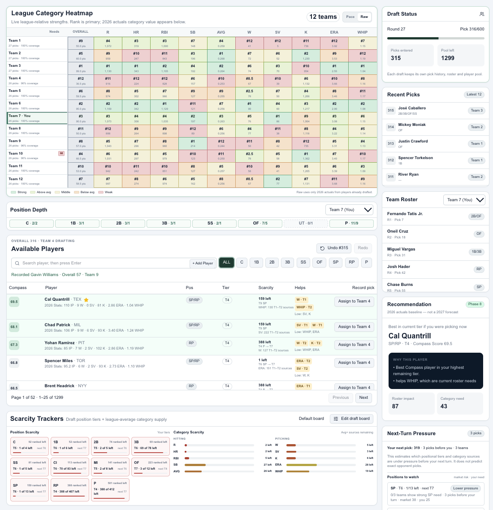
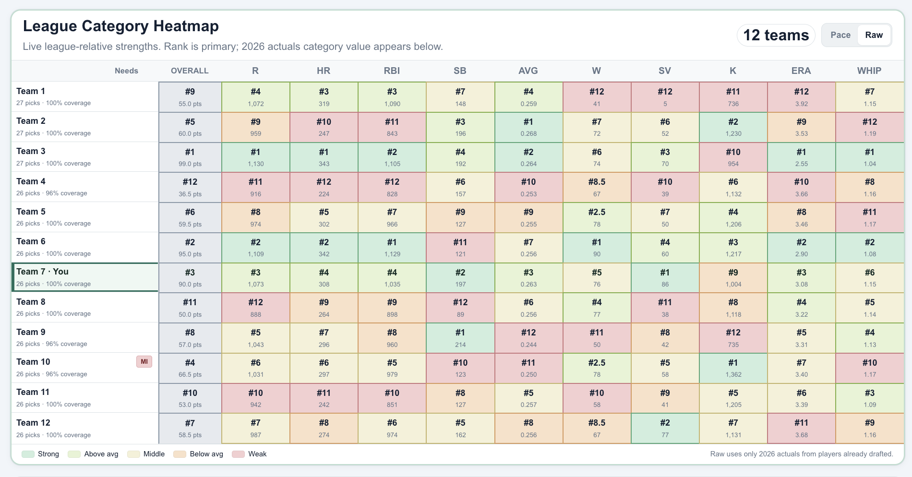
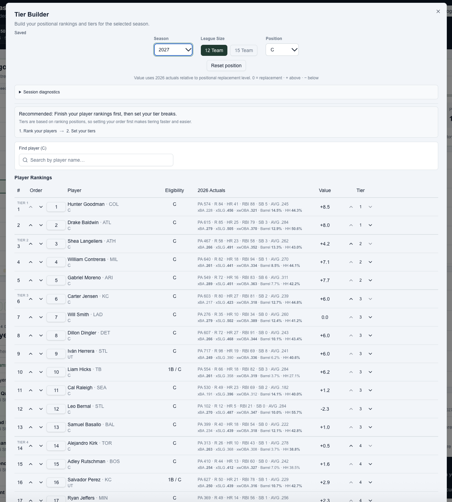

# Draft Compass

A fantasy baseball application that brings player data, personal rankings, roster analysis, and draft decision support into one workflow.

## The problem

Fantasy baseball drafting requires balancing player quality, positional needs, category contributions, and availability. Managing those decisions across separate spreadsheets and reference sites makes it harder to see how each pick affects the roster.

I built Draft Compass to bring that information together and make the decision process easier to follow.

## What it does

- Organizes player rankings and position tiers.
- Tracks draft picks and team rosters.
- Provides player recommendations informed by player quality and roster needs.
- Displays category comparisons and position depth.
- Supports season-specific statistical inputs, including historical actuals and selected projections.

## Application screenshots

### Draft workspace

Player recommendations, roster context, positional depth, and scarcity indicators support decisions during the draft.

### League category heatmap

Color-coded rankings and statistical totals show each team’s relative strengths and weaknesses across scoring categories.

### Personal rankings and tiers

Tier Builder lets users customize positional rankings and tier breaks alongside player statistics.

## My role

I lead the product direction, requirements, prioritization, and validation. I use Claude, Cursor, and other AI tools to support implementation, testing, troubleshooting, and iteration.

The work involves translating a practical problem into application behavior, evaluating tradeoffs, and checking that changes produce the intended results.

## Development priorities

- Make recommendations and supporting data understandable.
- Treat missing statistical inputs explicitly rather than presenting them as zero.
- Preserve personal rankings, manually assigned tiers, and existing draft history.
- Validate calculations and user workflows before releasing changes.
- Improve usability through repeated testing and feedback.

## Why this project matters to my work

Draft Compass extends my experience building dashboards, operating processes, and decision frameworks into hands-on application development. It provides a practical setting to explore how AI tools can turn detailed requirements into useful software, with human judgment guiding priorities and acceptance.

## Project status

Under active development. This repository presents the project; application source code is maintained separately.
